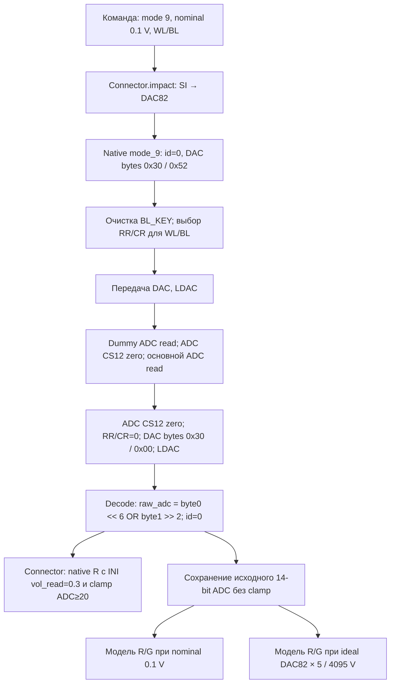

# Первое чтение физической платы

`read_all.py` — отдельный сценарий, не меняющий четырёхфазный эксперимент.
Он использует только публичные `Connector.open_port()`, `impact()` и
`close_port()`. Аппаратный драйвер импортирует сам штатный Connector.

По умолчанию выводится справка. `--dry-run` проверяет локальные исходники и INI
без подключения к плате. Неполная проверка FPGA encoder блокирует запуск.
На Raspberry необходима локальная копия проверенного установленного драйвера
в `vendor/MemriBoard/MemriCORE`; её не следует публиковать в Git. Используется
локальное окружение Raspberry, совместимое с её установленным драйвером;
Windows `.deps` переносить на Raspberry нельзя.

После отдельного разрешения оператора:

```text
python read_all.py --dry-run --cell 0,2
python read_all.py --run-hardware --cell 0,2
python read_all.py --run-hardware
```

Первый аппаратный вызов читает одну ячейку. Последняя команда читает все 256
адресов WL=0..7, BL=0..31, включая WL1, по одному разу. Это два независимых
запуска: сценарий не начинает полный проход после одиночной проверки сам.
Оператор должен исключить другие программы, использующие ту же плату;
локальный lock защищает только от параллельных запусков этого сценария.

Единственная команда — mode 9, номинально 0.1 В: SI→DAC82. При идеальной
опоре 5 В код соответствует 0.1001221001 В. `pulse_width=0` и `sign=0`
не управляют длительностью mode 9. Драйвер не использует параметры времени
из INI в этом режиме. Время установления и физическое напряжение не проверены.
Сам `open_port()` выполняет аппаратную инициализацию. `close_port()` штатного
Connector не доказывает отключение выходов; очистка выполняется mode 9 при
нормальном завершении, но её нельзя гарантировать после сбоя транспорта.

`configs/raspberry_board.ini` воспроизводит прочитанные параметры [board].
Connector использует его для SI→DAC и native R. Сам физический драйвер INI не
читает. Native R рассчитан с `vol_read=0.3`, поэтому при команде 0.1 В не
является оценкой сопротивления этой команды. Он сохраняется только как
полученное поле ответа, без подмены raw ADC. Кроме того, native R сначала
ограничивает ADC снизу значением 20, округляет R до двух десятичных знаков
и заменяет неположительный R значением `1e-8` Ом. Эти исправления не
применяются к сохранённому raw ADC или к отдельным модельным оценкам.

Ниже путь выполнения по прочитанным исходникам установленного драйвера.
Это описание команд и расчётов; физическое напряжение, сопротивление
и точность платы этим не измерены и не подтверждены.



Возврат, декодирование и очистка показаны в порядке реализации: результат
декодируется при return после очистки. При исключении очистка может не
завершиться. 14-bit означает формат декодирования, не подтверждённую точность.

**Правило для всех последующих изменений и агентов:** любое аппаратное
взаимодействие выполняется исключительно через публичные
`manager.board.Connector.open_port()`, `impact()` и `close_port()`.
Запрещены прямые вызовы SPI/GPIO/FPGA, импорт и вызов MemriCORE из сценария,
обращения к `Connector.interface`, обходы Connector и новый драйвер.
Исправление аппаратного сбоя не является разрешением обходить эту границу.

Отдельно сохраняются R/G по номинальным 0.1 В и по идеальной оценке DAC82.
Это **модельные, некалиброванные величины** по формуле делителя с параметрами
INI. Расхождение с реальной схемой/опорой/временем установления не оценено.
ADC=0, насыщение, некорректный ADC или неположительный R сохраняются с флагом,
без clamp и повторного измерения. Ошибка транспорта/ID останавливает проход.

Каждый запуск создаёт новый `results/read_all/<uuid>/`: snapshot INI, manifest
с SHA256, `raw.jsonl` с отдельной записью запроса до impact и ответа после него,
`audit.json` с покрытием адресов, ошибками и SHA256 сырых данных. Каждая строка
flush-ится. Завершённый проход не означает, что все значения валидны или что
плата прошла квалификацию. В summary нужно смотреть также flagged/missing.

Offline-проверки: `python -m unittest test_read_all -v`. Они используют только
FakeConnector, временные файлы и stdlib; физические драйверы не импортируются.
