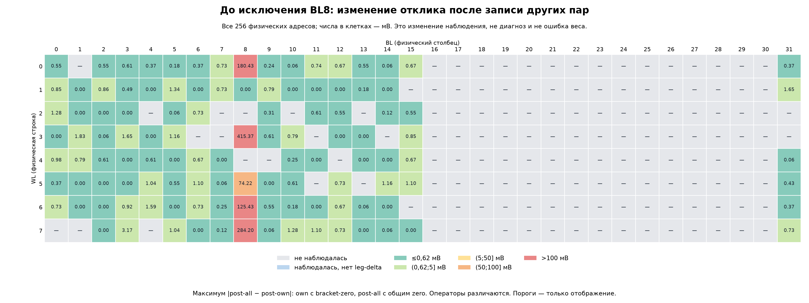
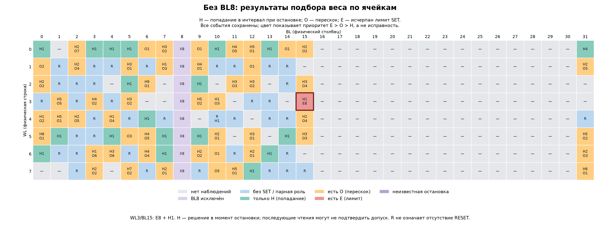

# План проверки расхождений MemriBoard и симулятора

Данные опытов 16 октября 2026; сокращённый отчёт от 17 октября. Нового прогона не было. Цель — повторить последовательность, при которой наблюдались ошибки, и выяснить их причину; повторение конкретной ошибки пока не гарантировано.

**Блок (тайл) — не ячейка.** Один знаковый вес задаётся разностью откликов двух ячеек. В одном блоке было до 7 весов, то есть до 14 выбранных ячеек. 300 коэффициентов четырёх фильтров размещались последовательно, в 44 блоках. Это не 300 одновременно записанных весов и не полный CIFAR-классификатор.

## Операция → ожидание → результат

Адреса WL/BL, номера фильтров и блоков начинаются с нуля. Веса указаны в единицах модели, не в единицах проводимости: HW-масштаб — 0,25 В выходного отклика на единицу веса. Числа ниже — до калибровочной матрицы, кроме сравнения Conv/LIF.

| Операция: что делаем для проверки | Что ждём | Что получили |
|---|---|---|
| **1. Запись отрицательного веса.** RESET пары P=WL2/BL1, N=WL3/BL15; затем SET отрицательной ноги с чтением после шагов. Цель −0,07389156; случай F1, блок 2, коэффициент 14. | Обратная связь достигает заданного интервала веса. Допуск остановки: max(5% целевого отклика, 0,5 ADC). | После 109 SET вес остался 0 — и сразу, и после записи блока. Всего на активной WL3/BL15 было **8 исчерпаний лимита и 1 остановка hit**. Это не доказательство «мёртвой» ячейки. |
| **2. Пересечение нужного уровня.** RESET пары P=WL2/BL3, N=WL3/BL3; SET отрицательной ноги до цели −0,06233993. F1, блок 9, коэффициент 67. | Остановиться внутри интервала, не перескочить его. | После 40 SET: остановка overshoot; свежий вес −0,085208, после блока −0,083504. В прогоне без BL8 **130 из 300** результатов — overshoot. SIM тоже даёт ошибки записи: идеальным эталоном он не является. |
| **3. Сохранение веса после записи других пар.** Записать и прочесть P=WL0/BL8, N=WL1/BL0; записать остальные пары того же блока; снова прочесть исходную пару. F0, блок 0, коэффициент 0. | При неизменной команде чтения отклик исходной пары сохраняется в пределах шума. | Вес **−0,046144 → +0,678992**. По всему исходному прогону нормированная ошибка весов **20,04% → 430,54%**; 47 пар с BL8 дали 99,79% суммы квадратов ошибок. В SIM изменения между этими стадиями не было. Причина в состоянии/адресации/тракте пока не установлена. |
| **4. Контроль без BL8.** Повторить предыдущую последовательность по заранее сохранённой раскладке без физической BL8. | Проверить, сохраняется ли большой уход отклика на другой раскладке. | Ошибка весов **16,91% → 16,86%**; максимальный сдвиг выхода одной ячейки **1,216 мВ** вместо **415,366 мВ** в исходном прогоне. Переназначены 160/300 пар: это улучшение, но не изолированный тест одной причины. |
| **5. Проверка сложения — MVM.** На одном состоянии сначала прочесть каждый вход BL отдельно; затем включить те же 2 или 4 BL одновременно в mode10. Вычесть нулевой отсчёт и сравнить с суммой одиночных ответов. | Одновременный ответ совпадает с суммой одиночных в пределах заранее заданного допуска; калибровку выбирать на отдельных данных. | HW: прошли **118/128** проверок для 2 входов и **51/128** для 4. Это пока операторские результаты: полный HW-журнал на Raspberry. SIM на собственном базисе: **256/256** проверок среднего ответа. Ошибка общей суммы не локализует дефект отдельной ячейки. |
| **6. Влияние ошибок на SNN.** Зафиксировать калибровку C на отдельных масках; измерить реальные одиночные вклады, сложить 75 коэффициентов, применить обученный BN и один шаг цифрового LIF. | Сопоставить фактические Conv и спайки HW/SIM на одинаковых входах, не подгоняя C по ответам CIFAR. | Прямое HW−SIM: **Conv RMSE 0,083512; 73/2400 различий спайков**, или 15/480 точек без повторов. LIF здесь цифровой: утечка 0,5, порог 1, сброс 0. Accuracy полного классификатора не измерена. |

### Общие условия повторения

Только штатный Connector и converters MemriBoard. Перед SET — RESET обеих ног и проверка тихого уровня. Mode7: RESET sign0, 0,3…3 В с шагом 0,05 (≤55 уровней); SET sign1, 0,3…3 В с шагом 0,025 (≤109). Mode10: номинальный вход 0,1 В, пять повторов. Перед импульсом проверяется свежий native R и прогноз V/R: ≤40 мА для RESET, ≤2 мА для SET. Это программная проверка, не измеренный импульсный ток. Физическая длительность штатного импульса неизвестна.

Исторические команды, конфигурации и ограничения: [REPRODUCTION.md](REPRODUCTION.md). В опытах чтения «сразу» и «после блока» использовались разные способы нулевой коррекции; их разность нельзя целиком приписать изменению мемристора.

## Карта ячеек по наблюдавшимся ошибкам

Ниже две отдельные карты разных сессий: их состояния не смешиваются. Адреса без данных не считаются исправными или неисправными. Вольты на карте — выход измерительного тракта, не напряжение непосредственно на мемристоре. Ошибки общей суммы MVM и спайков LIF до отдельных ячеек пока не локализованы.

Это неполный охват массива: исходный маршрут задействовал 114 адресов, маршрут без BL8 — 108 из 256. Большой серый участок не обосновывает исключение этих ячеек. Цель следующей раскладки — все 256 ячеек для четырёх фильтров; [план полного охвата](../../plans/EXPERIMENTS_20261019.md).

**Исходный прогон: изменение отклика после записи остальных пар блока.**

**Прогон без BL8: остановки записи на выбранной активной ячейке пары.** H — попадание в интервал в момент остановки; O — перескок; E — исчерпание лимита SET. Это исход операции с парой, привязанный к активной ячейке, а не диагноз физической неисправности. H не гарантирует сохранения веса при следующем чтении.

[Легенда, пороги и происхождение карт](cell-errors/MAP_README.md) · [Таблица всех ячеек и случаев](cell-errors/CELL_ERRORS.csv) · [Подробный отчёт с доказательствами](DETAILS_RU.md).
