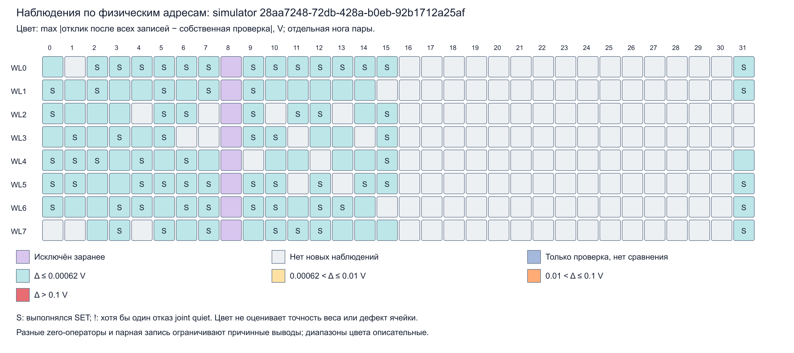

# Компактная карта и сводка noBL8 SIM — 16.10.2026

Это компактная публикация **симулятора**, session `28aa7248-72db-428a-b0eb-92b1712a25af`. Полный сбор: 300 свежих весов, 44 микротайла, 108 использованных адресов, 2400 выходов Conv1→BN→LIF. Независимый raw-аудит: PASS, 8 526 935 проверок, 0 ошибок. Аудит целостности не означает точность весов: критерий качества прошли 2/44 тайла, NRMSE 34.2136%, различий спайков с trained 60/2400.

- [Подробная сводка](REPORT.md), [SVG](MAP.svg), [256 адресов CSV](CELLS.csv), [300 весов CSV](WEIGHTS.csv).
- [Независимая научная проверка](SCIENTIFIC_REVIEW.md), [компактные повторные расчёты](SECONDARY_REVIEW.json), [SHA и происхождение](PROVENANCE.json).
- [Плановые заметки об охвате](PLANNED_COVERAGE_NOTES.md) и [параллельном MVM](PLANNED_PARALLEL_NOTES.md) — отдельный анализ, не новые измерения и не разрешение запусков.

Карта показывает наблюдения. Голубой цвет не квалифицирует точность веса, повторяемость программирования или физическую исправность. Фиолетовый BL8 исключён заранее; серый означает отсутствие нужного нового наблюдения. BL8=0 V в векторе не доказывает электрическую изоляцию линии. One-hot последовательные измерения и цифровые BN/LIF не являются квалификацией параллельного MVM или точностью полного классификатора.

**Полные raw-журналы, audit.json, SCIENCE.json и история измерений остаются в локальном checkout/Raspberry и в этот пакет не входят.** Здесь нет private-драйвера, весовых входных файлов или учетных данных. Их отсутствие нельзя считать отсутствием эксперимента, но один этот пакет не позволяет заново выполнить независимый raw replay. PROVENANCE.json фиксирует относительные пути и SHA полных локальных артефактов; вторичный review также ссылается SHA на не включённые SCIENCE.json.

Пакет не изменяет исходные отчёты или параметры опыта. Для воспроизведения анализа при наличии полного локального набора используется опубликованный [анализатор](../../../analyze_fresh_stability.py) и [инструкция](../../../FRESH_CONV1_STABILITY_ANALYSIS.md). Полная научная история сохраняется отдельно; новые аппаратные результаты сюда не подмешаны.
