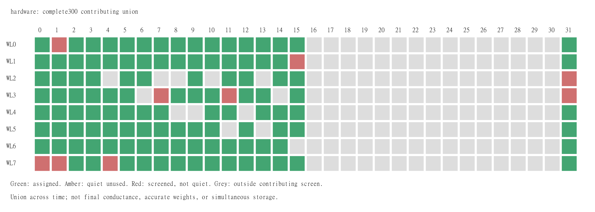
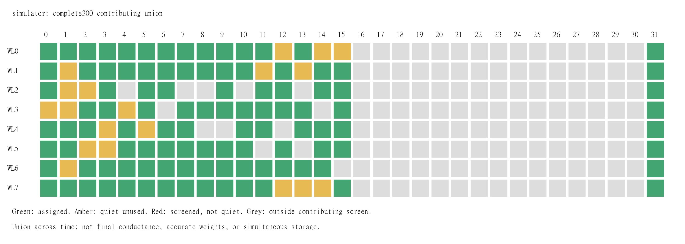

# Научный итог A/B/C: полный Conv1/BN/LIF, конечная проверка резервов

16 октября 2026. Получены все300 коэффициентов и2400 выходов четырёх
Conv1-фильтров для10 CIFAR100-патчей,12 логических тактов и5 повторов.
**Точность обученных весов не прошла квалификацию.** Завершение этого
ограниченного физического эксперимента не является accuracy классификатора
или доказательством абсолютного максимума массива.

## Проверенные источники

- HW B/C: `results/cifar_feedback_remaining_reserves/58ca618b-c37f-454e-be25-db21d1d25f60/`,
  source `418c4ad4ca1551d7733ccc4718ae85aab55937fa`, tracked clean;
  17:50:34–17:52:04 MSK. Manifest SHA
  `5fb5041cbdba148ff0a02182512a98ca0784fed074e2830d6fc06b230f933171`.
- HW audit `results/cifar_feedback_reviews/remaining_hardware_20261016/audit.json`:
  **PASS669378/0**, SHA
  `62a3f84f10ce55eb55be4930c605108a31440359d7e46c086d5f594a48ae162e`.
- SIM B/C `99631af1-c73e-42ed-abcd-20d4e580f691`, audit
  `results/cifar_feedback_reviews/remaining_simulator_20261016/audit.json`:
  **PASS604836/0**. Оба аудита используют frozen auditor
  `4f2f73eb96fd286aabde4e0513b7aac2ef96e57ef873ce36573a73a29a3b0525`.
- Соседний `comparison.json`, SHA
  `8dbc84618533c99f43e69e61adf0110e98262eff9c927ecded6e12024788f788`:
  binding аудитов, ancestry, использованных файлов и точных наборов outputs.

Scientific validator прочитал эти файлы и actual tile-результаты B/C,
сверил их SHA с manifest и отдельно проверил приведённые состояния,
пределы калибровки и причину отказа WL3/BL31. Полный raw replay выполнен
независимым аудитором; ещё один полный replay здесь не заявляется.

## Полнота, происхождение и затраты

B/C содержит **20 новых коэффициентов**,13 сохранённых из A и267 исходных.
Последние280 имеют прежние состояния/время измерения; их не выдают за новые.
Всё A/B/C вместе заменило33 исходных веса; это несколько сессий, не33
одновременно новых коэффициента последнего запуска. Каждый actual-вклад
получен через native MemriBoard, затем цифровую сумму всех75 taps,
обученный BN[t] и один цифровой LIF на t. Тайлы не добавляют leak/reset.
Одновременное аналоговое суммирование32 входов не проверялось.

Новые HW B/C: **26370 impacts /2163 ненулевых записей /0 current skips**,
1200 новых partial-точек. Contributing история конечного результата:
371008 impacts/30120 записей. Все попытки ancestry, включая заменённые и
старые неудачные измерения:420685/34376. Эти счётчики нельзя смешивать.
Длительность физического импульса остаётся неизвестной.

## Все десять заранее заданных резервов

В таблице «hit/exhausted» — исход pair feedback, а не гарантия accuracy
каждой ячейки. A-строки относятся к A-сессии; B/C — к последней сессии.
У всех допущенных здесь резервов fresh quiet mean=SD=0; порог0.00062 V.

| Резерв | Проверяемый факт | SET на резерве | Причина полученного статуса |
|---|---|---:|---|
| A WL6/BL2 | Назначен и измерен, f3/tap52 positive | 109 | Quiet прошёл; SET budget исчерпан, pair target не достигнут |
| A WL6/BL11 | Назначен и измерен, f3/tap53 positive | 109 | Quiet прошёл; SET budget исчерпан, pair target не достигнут |
| A WL7/BL15 | Назначен и измерен, f3/tap64 negative | 0 | Residual выбрал positive WL6/BL14:73 SET, pair hit; на negative писать не требовалось |
| B WL4/BL7 | Назначен и измерен, f2/tap0 positive | 0 | Отрицательный target реализован записью negative WL5/BL6; pair hit |
| B WL5/BL6 | Назначен и измерен, f2/tap0 negative | 61 | Pair hit; endpoint −0.041202 при target −0.04164168 |
| B WL5/BL15 | Назначен и измерен, f2/tap1 negative | 84 | Pair hit; endpoint −0.053346 при target −0.05589486 |
| C WL2/BL3 | Назначен и измерен, f1/tap0 positive | 109 | Quiet прошёл; SET budget исчерпан, endpoint0 при target +0.02245258 |
| C WL3/BL12 | Назначен и измерен, f1/tap0 negative | 0 | Residual выбрал positive WL2/BL3; эта пара не достигла target, но negative вклад измерен |
| C WL3/BL13 | Назначен и измерен, f1/tap1 negative | 0 | Positive WL2/BL0 получила41 SET, pair hit; endpoint +0.021056 при target +0.02258867 |
| C WL3/BL31 | Не допущен fresh quiet, не назначен | 0 | После55 RESET residual mean0.317832 V >0.00062 V; ramp exhausted |

У WL3/BL31 SD=0.00051036 V **ниже** порога0.00062 V. Отказ вызван
большим средним residual, а не превышением noise-порога. Это≈512.6× порога
по mean и наблюдение ограниченного RESET-протокола, не физический диагноз
«мёртвая ячейка». Исторический singleton-отклик не отменяет свежий отказ.
Для C/tap2 штатное заполнение маршрута выбрало negative WL3/BL2; это
измеренный заменяющий адрес, не CPU-подстановка и не возврат старого tap.

Таким образом,9 резервов фактически использованы,1 получил конечный
отрицательный fresh-screen результат. Ни один из этих десяти не остался
лишь непроверенным предположением. Этот finite-набор закрыт; утверждать
оптимальность среди всех256 адресов, состояний и режимов нельзя.

## Карта и значение цветов

HW contributing union: **123 screened,114 когда-либо quiet,114 assigned,
104 SET-attempted**. После A было108 assigned; B/C добавили6:
WL2/BL3, WL3/BL12, WL3/BL13, WL4/BL7, WL5/BL6, WL5/BL15.
Вытесненных уникальных assigned-адресов нет. От исходных105 прирост равен9.
На SIM конечный assigned union104; это не прогноз аппаратного поведения.

Зелёный — assigned/measured хотя бы в contributing состоянии, **не**
точность веса. Поэтому исчерпавшие SET WL6/BL2, WL6/BL11 и WL2/BL3
зелёные. Красный — screened, но не было qualifying quiet в contributing
истории; серый — вне её screening; жёлтый — quiet без назначения.
Карта не является снимком финальных проводимостей.

PNG получены из исходных соседних SVG через standard sharp/libvips,
density192. Обе карты визуально проверены: BL0–31, WL0–7 и легенда
читаются, обрезки нет. SVG/данные не менялись.

## Калибровочные матрицы и ограничения идентификации

B: C=diag(1.8,1.0011993643), d=0, selection-pass=true;
freeze before task9533, совпадающего с первым CIFAR task данного блока.
C: C=diag(1.0015285670,1.0022380451), d=0, selection-pass=true;
freeze before task7969. Task IDs локальны внутри блока; их нельзя
сравнивать как единую хронологию B→C.

Коэффициент1.8 у B достигает предусмотренной границы clip1.8; сам этот
факт не устанавливает физическую причину или физическое усиление канала:
max positive reference H всего0.000186 V, тогда как max negative H0.10456 V;
training condition≈13315.7. Формальный reference/training rank2 не равен
хорошей обусловленности. Среди B-кандидатов только identity/diagonal.
Diagonal чуть снизила независимый selection score0.0186345→0.0178417;
max singleton change0.0001488 V, RMS изменения весов всего0.00007705.
Это коррекция малого, слабо разрешённого отклика по frozen правилам,
не восстановление trained W и не уверенная оценка аналогового gain1.8.

Для C max singleton change0.00058618 V, RMS изменения весов0.00017653.
Матрицы fit по synthetic responses относительно measured H, без CIFAR
targets; corrected physical contribution `qᵀ C x / alpha_target`, d=0.
HW fixed alpha=1, SIM=.03. Последующие ошибки веса не исправляются
per-coefficient `w/measured` и не переносят trained W в CPU-actual.

## Точность весов и Conv/BN/LIF

| Набор | Weight RMSE после C | NRMSE | Дополнительная диагностика |
|---|---:|---:|---|
| HW B11 | 0.01636606 | 0.25937481 | 7 hits,4 exhausted; raw NRMSE0.259203→0.259807 после CIFAR |
| HW C9 | 0.08463784 | 1.66353420 | 5 hits,3 exhausted,1 overshoot; raw NRMSE1.660440→1.659569 |
| HW A/B/C33 | 0.06101507 | 1.14098495 | Совокупность трёх временных этапов |
| HW все300 | 0.07120826 | 1.34046685 | Полная physical weight quality=false |

Ни один свежий B/C-блок не прошёл fidelity. У B нет разрешённых ошибок
знака; у C одна (slot5), плюс неразрешённый значимый знак slot0.
Причины крупных residual не установлены; valid audit доказывает
согласованность данных/протокола, а не точность программирования.

| Сравнение | Conv RMSE | Различия спайков /2400 |
|---|---:|---:|
| HW−trained | 0.265705291 | 45 |
| HW−own W_eff | 0.001567752 | 0 |
| SIM−trained | 0.051685602 | 50 |
| HW−SIM | 0.286371603 | 85 |

HW−trained по фильтрам0/1/2/3: Conv RMSE0.09728634/0.40543476/
0.04486139/0.32640877; различий спайков15/10/5/15 из600 каждого.
Согласие с own W_eff означает, что actual-оператор и цифровой LIF
согласуются с полученными весами. Оно не подтверждает trained accuracy.

У HW Conv repeat RMS sample SD0.00127287, max range0.01798057;
max pre/post-LIF range0.08555766. Спайки неизменны между пятью повторами:
45 различий с trained соответствуют9 уникальным filter/case/t, а не45
независимым ошибкам. Пороговая устойчивость спайков не означает равенства
мембранных потенциалов, долгосрочной стабильности или отсутствия шума.

Практический итог: полная ограниченная физическая выборка и конечная
проверка всех заранее известных резервов завершены. Получены воспроизводимые
артефакты и явные отрицательные результаты записи/RESET. Точная запись
обученных весов, classifier accuracy и абсолютная оптимальность остаются
недоказанными. Это инженерная методика; литературный приоритет не исследован.
